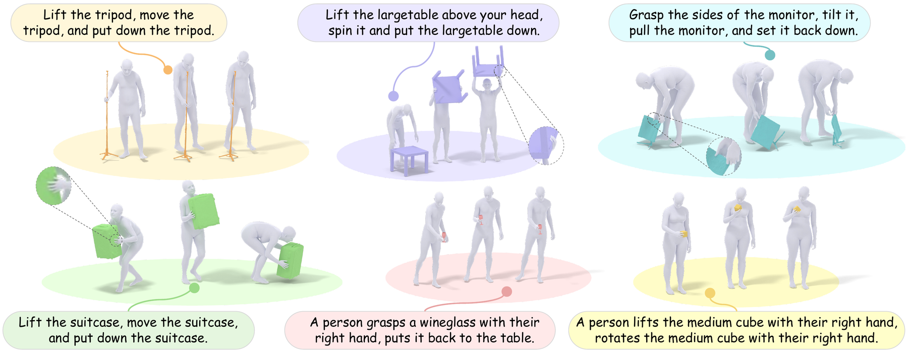
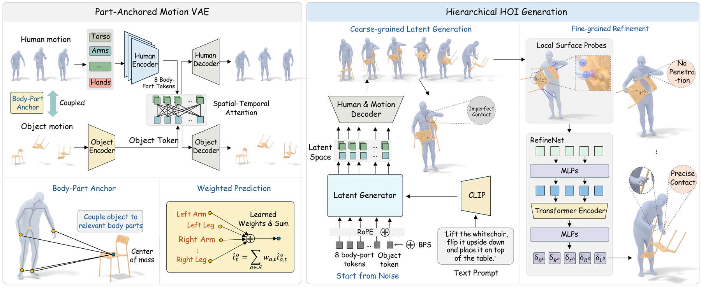

# PAMI: Part Anchored Motion for Text to Human-Object Interaction Generation

<p align="center">
  <a href="https://coral79.github.io/pami/"><b>[🌐 Project Page]</b></a>
  <a href="https://arxiv.org/abs/2609.38466"><b>[📄 Paper]</b></a>
</p>

<p align="center">
  
</p>

This is the official repository for **PAMI**.

---

## 🚀 News
- **[Sep 2026]** Our paper has been submitted to arXiv!
- **[Nov 2026]** Pre-trained checkpoints, training & inference code, and the evaluation pipeline are now released!

## 📦 Release Progress
- [x] **Data Preparation**: InterAct → part-anchored interaction representation.
- [x] **Model Weights**: PamiVAE, PamiGen and PamiRefiner.
- [x] **Inference Code**: text-to-interaction generation.
- [x] **Training Code**: all three modules.
- [x] **Evaluation**: evaluation code and metrics.

---

## 📄 Abstract
Text-conditioned full-body human–object interaction (HOI) generation requires synthesizing human motion and object trajectories that match the input text while remaining precisely coordinated over time. Most methods represent the human and object as separate trajectories and predict the global human–object couplings. Learning this complex, dynamically changing relationship implicitly, however, often yields object drift, missed contact, and penetration.

We introduce **PAMI**, a Part-Anchored Motion framework for Interaction generation. Inspired by the classic Hough Transform, our key idea is to localize object motion by letting body-part anchors vote for it: we express object motion relative to multiple body-part anchors and use **PamiVAE** to learn an interaction latent space, decoding frame-wise weights that aggregate these part-specific votes. Building on this representation, PAMI generates interactions in a coarse-to-fine hierarchy. **PamiGen** first generates a coarse human–object interaction from text in this structured latent space, and **PamiRefiner** then recursively resolves fine-grained contact geometry using a hybrid surface-sensing representation, combining long-range probes that capture overall body-part influence with short-range sensors that resolve detailed contacts near the object surface.

Experiments on InterAct show that PAMI generates more faithful interactions and more accurate human-relative object motion than previous methods, achieving 14.5% higher contact recall than the previous state of the art. Extensive ablations validate the contributions of both the part-anchored voting representation and hybrid surface-sensing refinement.

<p align="center">
  
</p>

---

## ⚙️ Installation

Tested with **Python 3.10**, **PyTorch 2.7.1**, **CUDA 11.8**.

```bash
# 1. Clone the repo
git clone https://github.com/Coral79/PAMI-Code.git
cd PAMI-Code

# 2. Create the conda env
conda create -n pami python=3.10 -y && conda activate pami
pip install torch==2.7.1 torchvision==0.22.1 --index-url https://download.pytorch.org/whl/cu118   # RTX 50-series: .../whl/cu128
pip install numpy==1.22.0 scipy==1.11.4 six && pip install --no-build-isolation chumpy==0.70
pip install -r environment/requirements.txt

# 3. OpenAI CLIP (caption features, free-text prompts)
pip install ftfy regex && pip install --no-deps git+https://github.com/openai/CLIP

# 4. (For evaluation) the dependencies of LIGHT's evaluator
conda install -c nvidia/label/cuda-11.8.0 cuda-nvcc cuda-cudart-dev cuda-cccl libcublas-dev libcusparse-dev libcufft-dev libcurand-dev libcusolver-dev -y
pip install fvcore iopath ninja
FORCE_CUDA=1 CUDA_HOME=$CONDA_PREFIX pip install --no-build-isolation \
    "pytorch3d @ git+https://github.com/facebookresearch/pytorch3d.git@75ebeeaea0908c5527e7b1e305fbc7681382db47" \
    "chamfer_distance @ git+https://github.com/otaheri/chamfer_distance@f86f6f7cadd3aca642704573d1626c67ca2e2846"
pip install -r environment/requirements-eval.txt
```

Notes and troubleshooting: [`environment/README.md`](environment/README.md).

---

## 🗂️ Data Preparation

<details>
<summary><b>Click to expand</b></summary>

PAMI is trained and evaluated on **[InterAct](https://github.com/wzyabcas/InterAct)**. The data and body models cannot be redistributed. Details: [`docs/DATA.md`](docs/DATA.md).

### 1. Download InterAct

Clone the [InterAct repository](https://github.com/wzyabcas/InterAct) to `data/InterAct` and follow its data instructions (including `omomo_correct_v2`, `behave_correct`, `grab_smplh`, `intercap_correct_poses`).

### 2. Download the LIGHT-format data

Clone [LIGHT](https://github.com/wzyabcas/LIGHT#installation) to `data/LIGHT` and download its processed dataset. It provides the official test lists and the object meshes.

### 3. Obtain the body models

Register and download SMPL, SMPL-H and SMPL-X, download the two vertex segmentation files, and place them in `data/repr272/body_models`:

```
body_models/
  smpl/SMPL_NEUTRAL.pkl                     # https://smpl.is.tue.mpg.de/
  smplh/{male,female,neutral}/model.npz     # https://mano.is.tue.mpg.de/
  smplx/SMPLX_{MALE,FEMALE,NEUTRAL}.npz     # https://smpl-x.is.tue.mpg.de/
  smplx/SMPLX_MALE.pkl
  smpl_vert_segmentation.json               # https://github.com/Meshcapade/wiki (assets/SMPL_body_segmentation/smpl)
  smplx_vert_segmentation.json              # https://github.com/Meshcapade/wiki (assets/SMPL_body_segmentation/smplx)
```

### 4. Build the representation

```bash
python prepare_data.py convert         # 1  object 6-DoF, body-part anchors, part-anchored object channels
python prepare_data.py repr272         # 2  272-dim human representation
python prepare_data.py hand_joints     # 3  finger joints
python prepare_data.py shape_aligned   # 4  object surface normals
python prepare_data.py manifest_split  # 5  training windows + splits
python prepare_data.py stats           # 6  normalisation statistics
python prepare_data.py text            # 7  captions + pieces
python prepare_data.py text_feats --out data/pami_data/gen_corpus    # 8  CLIP caption features
python prepare_data.py test_pool  --out data/pami_data/test_pool     # 9  test list
```

`python prepare_data.py all` runs 1–7 and 9. The per-sequence stages are resumable and take `--shard i/n`.

### 5. Encode the latents

Needs `checkpoints/pamivae.pt` (§📥 Pre-trained Models):

```bash
python encode_latents.py
```

The normalisation statistics of the released models come with the checkpoints (`checkpoints/stats`). To use your own from stage 6, e.g. when training from scratch: `export PAMI_STATS_DIR=$PWD/data/pami_data`.

### Expected directory structure

```
data/
  InterAct/                 # InterAct clone with its data/ folder
  LIGHT/                    # LIGHT clone
  repr272/
    body_models/
    output_interact_30fps/  # written by prepare_data.py
  pami_data/                # written by prepare_data.py
checkpoints/
```

Folders can live elsewhere: set `INTERACT_ROOT` (InterAct's `data/`), `LIGHT_ROOT`, `REPR272_ROOT`, `PAMI_DATA_ROOT` (`python prepare_data.py paths` prints them).

</details>

---

## 📥 Pre-trained Models

Download from **[Google Drive](https://drive.google.com/drive/folders/12B0QkcbrgKtKX5JdECtpk7LpBfVKdSzd?usp=sharing)** and unpack in the repository root.

| Archive | Size | Contents |
|---|---|---|
| `pami_checkpoints_inference.tar` | 3.5 GB | PamiGen, PamiVAE and PamiRefiner for inference, with their normalisation statistics |
| `pami_checkpoints_training.tar` | 3.9 GB | full PamiGen and contact-tuned PamiVAE checkpoints, only needed for training |

```bash
pip install gdown
gdown 11-CTdhP91fSzb8U2-oONixJMv8IYAYc6 --continue    # pami_checkpoints_inference.tar
gdown 1giYh1TVq5K5O-354LhI4-91lK-4_rrpb --continue    # pami_checkpoints_training.tar (optional)

tar -xf pami_checkpoints_inference.tar
tar -xf pami_checkpoints_training.tar                 # optional
```

---

## 🎬 Inference

<details>
<summary><b>Click to expand</b></summary>

> **Prerequisites.** §🗂️ Data Preparation and §📥 Pre-trained Models.

### Option 1 (default): sample test-split prompts

```bash
python generate.py --split_part test --pieces 2 9 13 --seed 6 --out outputs/samples_demo
python refine.py --samples_glob "outputs/samples_demo/gen_*.npz" --out_dir outputs/refined_demo
```

`--pieces` are indices into the test-split piece list (`data/pami_data/test_pool/pieces_test.txt` lists the official test pieces).

Output files:
- `outputs/samples_demo/gen_<piece>_<sequence>.npz` — coarse sample from PamiGen
- `outputs/refined_demo/refined_<sequence>.npz` — refined result: `joints52 (T,52,3)`, `R_obj (T,3,3)`, `p_obj (T,3)`

### Option 2: generate from a custom prompt

The object, body shape and length are taken from a reference test piece (piece 10 is a baseball bat). Requires the optional CLIP install.

```bash
python generate.py --text "Swing the baseball bat with both hands." --ref_piece 10 --out outputs/samples_text
python refine.py --samples_glob "outputs/samples_text/gen_*.npz" --out_dir outputs/refined_text
```

### Visualisation

Render ground truth and results side by side into a video with [aitviewer](https://github.com/eth-ait/aitviewer), see [`extras/README.md`](extras/README.md):

```bash
python extras/render_aitviewer/render_hoi_aitv.py --seq <sequence> --gt --panels outputs/refined_demo --labels PAMI
```

</details>

---

## 🏋️ Training

<details>
<summary><b>Click to expand</b></summary>

> **Prerequisites.** §🗂️ Data Preparation, all stages.

The defaults of every script are the paper's settings. All runs are single-GPU.

### 1. PamiVAE

```bash
python train_vae.py --iters 200000 --save_every 25000 --seed 0 --run_name main
python train_vae.py --finetune_decoder_contact --resume_full outputs/vae/pamivae_main_resume.pt --seed 0 --run_name contact
```

### 2. PamiGen

```bash
python encode_latents.py --ckpt outputs/vae/pamivae_main_200000.pt
python train_gen.py --iters 400000 --save_every 20000 --seed 0 --run_name main --vae_tag main_200000_refined
```

### 3. PamiRefiner

Sample the train split with `generate.py --split_part train` (three draws), build the banks, then train:

```bash
# banks: for each draw d1/d2/d3 and for --stream gen / roundtrip (validation banks: same, from --split_part val samples)
python build_bank.py --init     --out banks/d1_train_gen/items --gen_glob "outputs/samples_train_d1/gen_*.npz" --stream gen --varlen
python build_bank.py --append   --out banks/d1_train_gen/items --gen_glob "outputs/samples_train_d1/gen_*.npz" --stream gen --varlen
python build_bank.py --finalize --out banks/d1_train_gen/items

python train_refiner.py --rt_bank banks/d1_train_rt/items banks/d2_train_rt/items banks/d3_train_rt/items \
    --gen_bank banks/d1_train_gen/items banks/d2_train_gen/items banks/d3_train_gen/items \
    --val_rt_bank banks/val_rt/items --val_gen_bank banks/val_gen/items --out outputs/refiner/pamirefiner.pt
```

Checkpoints are written to `outputs/vae`, `outputs/gen` and `outputs/refiner`.

</details>

---

## 📊 Evaluation

<details>
<summary><b>Click to expand</b></summary>

> **Prerequisites.** Refined results from §🎬 Inference, and LIGHT's evaluator checkpoint at `data/LIGHT/assets/evaluator.ckpt` ([LIGHT README](https://github.com/wzyabcas/LIGHT#installation), step 5).

We follow the evaluation protocol of LIGHT / InterAct. Details: [`docs/EVAL.md`](docs/EVAL.md).

### Run the evaluation

```bash
export LIGHT_ROOT=$PWD/data/LIGHT
export OPENBLAS_CORETYPE=Haswell OMP_NUM_THREADS=1 MKL_NUM_THREADS=1 OPENBLAS_NUM_THREADS=1
python evaluate.py --pred_dir outputs/refined_demo --out outputs/eval/refined_demo.json
```

</details>

---

## 👀 You Might Also Like

- 🧟 **[FrankenMotion](https://coral79.github.io/frankenmotion/)** (CVPR 2026) — part-level human motion generation and composition with the Frankenstein dataset.
- 🎯 **[ActionPlan](https://coral79.github.io/ActionPlan/)** (ECCV 2026) — future-aware streaming motion synthesis via frame-level action planning.

---

## ✍️ Citation
If you find our work or code useful for your research, please consider citing:

```bibtex
@article{li2026pami,
  title={{PAMI}: Part Anchored Motion for Text to Human-Object Interaction Generation},
  author={Li, Chuqiao and Xie, Xianghui and Cao, Yong and Geiger, Andreas and Pons-Moll, Gerard},
  journal={arXiv preprint arXiv:2609.38466},
  year={2026}
}
```

---

## 📜 License

This project is released under a non-commercial research license. See [LICENSE](LICENSE) for details.

The InterAct data and the SMPL / SMPL-H / SMPL-X body models are subject to their own licenses and must be obtained separately.

### Acknowledgements

- Evaluation: [LIGHT](https://github.com/wzyabcas/LIGHT) and [InterAct](https://github.com/wzyabcas/InterAct)
- 272-dim human motion representation: [MotionStreamer](https://github.com/zju3dv/MotionStreamer)
- Rendering: [aitviewer](https://github.com/eth-ait/aitviewer)

---

## ⭐ Star History

[](https://star-history.com/#Coral79/PAMI-Code&Date)
